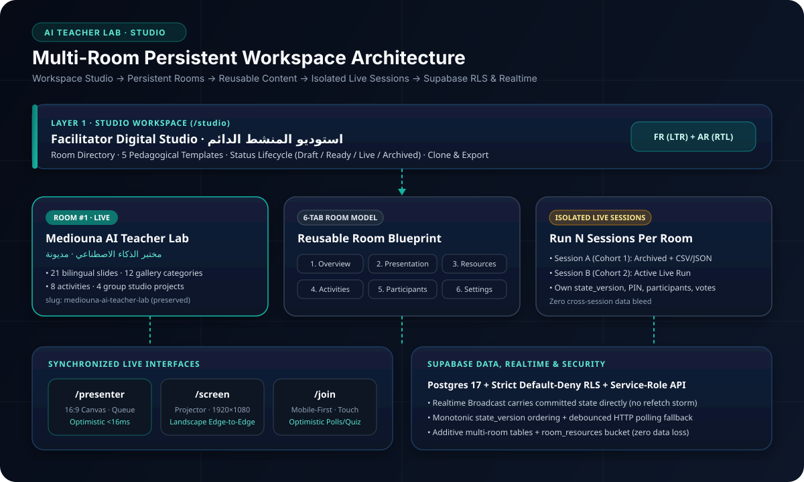

# AI Teacher Lab Studio — Multi-Room Persistent Workspace Architecture

> **Status:** Architectural Blueprint & Interactive Studio UI Prototype (`/studio`)  
> **Scope:** Evolves AI Teacher Lab from a single workshop (`mediouna-ai-teacher-lab`) into a permanent facilitator digital studio supporting multiple rooms, presentations, reusable resources, activities, and isolated live sessions — while preserving 100% of existing workshop data and simultaneous French (LTR) + Arabic (RTL) presentation.



---

## 1. Product Vision & Information Architecture

Today, AI Teacher Lab operates around one active workshop record (`workshops.slug = 'mediouna-ai-teacher-lab'`) with three synchronized views (`/presenter`, `/screen`, `/join`). As the platform grows into a permanent digital studio for workshops, institutional briefings, teacher trainings, and classroom demos, the facilitator needs a top-level **Studio Workspace** (`/studio`) where every room is prepared once and launched repeatedly.

### Navigation Hierarchy

```text
/                       → Editorial Landing & Quick Entry (/studio, /presenter, /join, /screen)
/studio                 → Persistent Multi-Room Workspace Home
  ├── Room Directory    → Search, filter (Live / Ready / Draft / Archived), duplicate, create from template
  └── Room Inspector    → 6-tab room model:
        1. Overview      (Vue d'ensemble · نظرة عامة)
        2. Presentation  (Présentation · العرض التقديمي)
        3. Resources     (Ressources · الموارد والملفات)
        4. Activities    (Activités · الأنشطة التفاعلية)
        5. Participants  (Participants · المشاركون والنتائج)
        6. Settings      (Paramètres · الإعدادات والولوج)
/presenter              → Live 16:9 Presenter Console (future: /rooms/[slug]/presenter)
/screen                 → Live 16:9 Projector Display (future: /rooms/[slug]/screen)
/join                   → Mobile-First Participant Companion (future: /rooms/[slug]/join)
```

Backward-compatible root routes (`/presenter`, `/screen`, `/join`) remain permanent aliases pointing to the active default room (`mediouna-ai-teacher-lab`) so existing QR codes, bookmarks, and printed workshop handouts never break.

---

## 2. Core Domain Separation: Persistent Room vs. Isolated Live Session

A critical design flaw in single-workshop tools is mixing **reusable workshop content** with **ephemeral live participant responses**. AI Teacher Lab Studio separates the two cleanly:

| Concept | Lifespan | What It Owns |
|---|---|---|
| **Room (`rooms` / `workshops`)** | Permanent, reusable | Title (FR+AR), slug, template type, slide deck definition or uploaded assets, pedagogical resources, activity blueprints (polls, quizzes, prompt builders), room-level branding, and default PIN/passcode policy. |
| **Live Session (`room_sessions`)** | Per-event run (`scheduled`, `live`, `ended`, `archived`) | Active `current_slide_id`, `state_version`, `activity_status`, `show_results`, `demo_mode`, timer state, QR overlay flag, joined `participants`, submitted `responses`, and exportable summary snapshots. |

### Practical Benefit for the Facilitator
1. **Run the same workshop with 5 different teacher cohorts** without overwriting or purging previous cohorts' analytics.
2. **Prepare slides, polls, and downloadable guides days in advance** in `draft` or `ready` status, then click **Launch Live Session** when participants arrive.
3. **Preserve every session's results** (`archived`) for institutional reporting (Centre de Digitalisation / Direction Provinciale de Mediouna) while starting a fresh clean session for the next group.

---

## 3. Room Templates (5 Pedagogical Blueprints)

The Studio ships with 5 ready-to-clone bilingual templates:

1. **Bilingual Teacher Workshop (`workshop-bilingual`)** — Full 16:9 slide deck + icebreaker poll + diagnostic quiz + hands-on Prompt Builder & Meta-Prompt lab + showcase voting + exit ticket (modeled on the Mediouna Room #1).
2. **Institutional Briefing Deck (`presentation-deck`)** — Clean 16:9 presentation canvas + presenter notes + optional Q&A / live feedback poll for leadership and inspection audiences.
3. **Live Quiz & Poll Arena (`quiz-arena`)** — High-engagement rapid polls, MCQ, and True/False formative checks with instant projector reveal charts.
4. **Pedagogical App Creation Lab (`app-studio-lab`)** — Group project briefs, 12 pedagogical app categories, structured prompt templates, and collaborative gallery submission.
5. **Training Seminar & Resources Hub (`seminar-hub`)** — Resource-heavy room for downloadable PDFs, classroom guides, reference links, and post-session evaluation.

---

## 4. The 6-Tab Room Workspace Model

| Tab | French · Arabic | Capabilities |
|---|---|---|
| **1. Overview** | Vue d'ensemble · نظرة عامة | Room status badge, one-click launch to `/presenter`, `/screen`, `/join`, copyable share link, live attendance/response counters, and recent session history. |
| **2. Presentation** | Présentation · العرض | Slide deck inventory (21 slides in Room #1), 16:9 logical canvas metadata, section timeline, presenter script preview, and future deck import/reorder. |
| **3. Resources** | Ressources · الموارد | Structured links, pedagogical app gallery (12 categories), group briefs (4 projects), and future Supabase Storage attachments (PDF, HTML prototypes, images). |
| **4. Activities** | Activités · الأنشطة | Complete list of room polls, MCQ/TF quizzes, Prompt Builder, Meta-Prompt, Showcase Voting, and Exit Ticket with open/close/reveal controls and response totals. |
| **5. Participants** | Participants · المشاركون | Active vs. archived session metrics, live response rate, Demo Mode vs. Real Mode separation, anonymized recent submissions, and post-event export/purge controls. |
| **6. Settings** | Paramètres · الإعدادات | Room slug, simultaneous FR+AR titles, room-scoped join PIN policy, facilitator passcode policy, privacy/no-student-PII pledge, and room archival. |

---

## 5. Access & Permissions Model (Pragmatic, Zero-Friction)

To stay aligned with real Moroccan public-school workshop realities (no mandatory teacher account registration, instant QR join on mobile phones, zero student PII):

- **Participants** never create accounts. They join a room's active session via QR code or `/join?room=<slug>` + room-scoped 4–6 digit **Room PIN** + display name/initials, receiving an `HttpOnly` HMAC-signed session cookie scoped to `(room_id, session_id, participant_id)`.
- **Facilitators** authenticate via room-scoped (or workspace-master) **Facilitator Passcode**, receiving an `HttpOnly` signed presenter cookie. All mutations pass through server-side Next.js Route Handlers using the Supabase `service_role` client.
- **Database Security**: Every table remains **default-deny RLS** for `anon` and `authenticated`. Realtime Broadcast uses short-lived scoped channel tokens restricted to `workshop:<room_id>:session:<session_id>`.
- **Deferred intentionally**: Full multi-tenant SaaS auth, OAuth sign-ups, and billing are explicitly out of scope for this phase.

---

## 6. Bilingual & Mobile-First Design Contract

1. **Simultaneous FR (LTR) + AR (RTL)** on every Studio card, tab, form field, status badge, and button — never a language toggle.
2. **Fixed 16:9 Presentation Stage** (`1920 × 1080` logical canvas) across Presenter and Projector; rotated mobile phones (`landscape`, viewport height `≤ 500px`) automatically collapse chrome so the slide fills the screen with discreet tap-to-reveal overlay controls.
3. **Instant Feedback Everywhere**: Optimistic local transitions (`< 16ms`) paired with non-blocking serialized server persistence, explicit inline retry on failure, and fixed-width debounced connection badges with zero layout shift.
